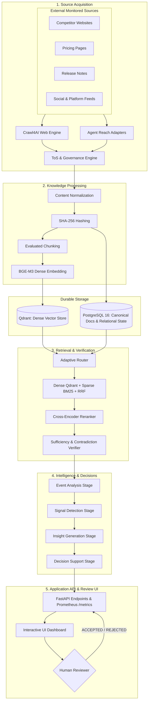

# Competitive Intelligence Monitoring Platform

A production-grade, evidence-grounded strategic competitive intelligence and decision-support platform. It continuously tracks competitor actions across websites, pricing structures, documentation, and platform sources, transforming raw market signals into auditable, prescriptive strategic recommendations subject to strict human operator boundaries.

[](https://www.python.org/)
[](pyproject.toml)

---

## Live Demo

- **Live demo:** `<add your live demo URL here>`
- **2-minute walkthrough video:** `<add your recording link here>` (use this if the free instance is waking up, which can take 2 to 3 minutes)

> **About the live demo's embeddings:** the live demo uses a small embedding model
> (`BAAI/bge-small-en-v1.5` via fastembed) so it can run on a free 512 MB host. BGE-M3 is the
> production default, and all benchmark and evaluation numbers in this repository were
> produced with BGE-M3. Retrieval quality in the live demo is somewhat lower.

The demo is a **read-only workspace with fictional data**: three invented competitors in a
product-analytics market, seeded through the real pipeline on every boot. What to click:

1. **Strategic Insights → Actionable Recommendations → "Trace to sources"**: follow one
   `PROPOSED` recommendation down all 10 provenance layers to the exact quote, the SHA-256
   hash of the document version, and the source URL.
2. **Ask the Evidence**, mode **Agentic**, question *"Does the Northwind Free plan really
   include 3 seats?"*: watch query analysis, sub-queries and verification run, including the
   deterministic cross-document check that flags the pricing page and a customer review
   disagreeing (3 seats vs 1).
3. **Approve or reject** a recommendation: the human decision boundary. Nothing is ever
   executed automatically. Everything else that writes (creating sources, crawling,
   running workflows) is disabled in the demo.

How the demo stays free and safe: see [Deploy to Render](#deploy-to-render).

---

## Key Characteristics

- **Production-First Agentic RAG**: Bounded query decomposition, sufficiency validation, and cross-source contradiction detection via deterministic state machine orchestration.
- **Strict 10-Layer Provenance**: Unbroken backward auditability from the final strategic recommendation down to the exact source chunk, document version, and canonical origin URL.
- **Mandatory Human Decision Boundary**: Prescriptive recommendations are generated strictly in the `PROPOSED` status. Autonomous execution of business decisions is architecturally prohibited; changes require explicit operator review (`ACCEPTED` or `REJECTED`).
- **Deterministic Over LLM**: Cryptographic hashing (SHA-256), change detection, chunking, deduplication, and score fusion (RRF) are strictly deterministic. LLMs are reserved for structured semantic interpretation and option synthesis.
- **Multi-Tenant Isolation**: Complete workspace and tenant isolation enforced at database schema, vector payload, and retrieval filter levels.
- **Budget & Token Aware**: Strict per-task ceilings on LLM calls, token budgets, and retrieval hops.

---

## System Architecture



---

## 10-Layer Provenance Chain

```
[Layer 1: Recommendation] (Title, status: PROPOSED, urgency, trade-offs)
   │
[Layer 2: Selected Option] (Action type, predicted effects, identified risks)
   │
[Layer 3: Decision Context] (Business objectives, constraints, time horizons)
   │
[Layer 4: Supporting Insights] (Titles, statements, factual/interpretive confidence)
   │
[Layer 5: Inferred Signals] (Detected trajectories, market direction)
   │
[Layer 6: Supporting Events] (Discrete factual occurrences, detected timestamp)
   │
[Layer 7: Raw Evidence] (Direct quotes, evidence role: primary direct / context)
   │
[Layer 8: Document Chunks] (Chunk ID, token count, character offsets)
   │
[Layer 9: Document Version] (Content SHA-256 hash, acquisition timestamp)
   │
[Layer 10: Monitored Source] (Source ID, canonical URL, platform type)
```

---

## Subsystem Inventory

| Subsystem | Source Path | Description |
| :--- | :--- | :--- |
| **Source Acquisition** | [`src/competitive_intelligence/source_acquisition/`](src/competitive_intelligence/source_acquisition/) | Multi-source crawlers (`Crawl4AI`), social adapters, rate limiters, ToS governance. |
| **Knowledge Pipeline** | [`src/competitive_intelligence/knowledge_pipeline/`](src/competitive_intelligence/knowledge_pipeline/) | Normalization, change detection, semantic chunking, `BGE-M3` embeddings, `Qdrant` vector storage. |
| **Retrieval Engine** | [`src/competitive_intelligence/retrieval_engine/`](src/competitive_intelligence/retrieval_engine/) | Sparse BM25, dense vector search, Reciprocal Rank Fusion (RRF), cross-encoder reranking. |
| **Agentic RAG** | [`src/competitive_intelligence/agentic_rag/`](src/competitive_intelligence/agentic_rag/) | Multi-hop query decomposition, sufficiency checking, contradiction detection, bounded reasoning. |
| **Intelligence** | [`src/competitive_intelligence/intelligence/`](src/competitive_intelligence/intelligence/) | Event analysis, signal inference, strategic insight generation with multi-dimensional confidence. |
| **Decision Support** | [`src/competitive_intelligence/decision_support/`](src/competitive_intelligence/decision_support/) | Option evaluation, hard constraint filtering, prescriptive proposal assembly (`PROPOSED`). |
| **Continuous Monitoring** | [`src/competitive_intelligence/monitoring/`](src/competitive_intelligence/monitoring/) | Background scheduler daemon, lease acquisition, distributed heartbeat, worker failover. |
| **Application & UI** | [`src/competitive_intelligence/application/`](src/competitive_intelligence/application/) | FastAPI REST endpoints, web dashboard, operator review workflows, Prometheus `/metrics`. |

---

## Getting Started

### Option A: Running with Docker Compose (Recommended)
```bash
# 1. Clone repository and set environment
git clone <repo-url>
cd competitive_intelligence
cp .env.example .env

# 2. Launch production stack
docker compose up -d

# 3. Verify health
curl http://localhost:8000/health
```

### Option B: Local Development
```bash
# 1. Create and activate virtual environment
python -m venv .venv
source .venv/bin/activate  # On Windows: .venv\Scripts\activate

# 2. Install dependencies (runtime extras + dev tools)
pip install -e ".[all]"

# 3. Run the test suite (hermetic: never reads your .env or calls a real LLM)
python -m pytest tests/ -q

# 4. Run static type checker
python -m mypy src

# 5. Start API server
uvicorn competitive_intelligence.application.api.app:app --host 0.0.0.0 --port 8000 --reload
```

---

## API Endpoints & Interfaces

- **API Documentation**: [`http://localhost:8000/api/v1/docs`](http://localhost:8000/api/v1/docs) (Swagger UI) & [`/api/v1/redoc`](http://localhost:8000/api/v1/redoc)
- **Operator Web Dashboard**: [`http://localhost:8000/`](http://localhost:8000/)
- **Prometheus Metrics**: [`http://localhost:8000/metrics`](http://localhost:8000/metrics)
- **Health Probes**: [`http://localhost:8000/health`](http://localhost:8000/health), [`/health/live`](http://localhost:8000/health/live), [`/health/ready`](http://localhost:8000/health/ready)

### Key REST Routes:
- `POST /api/v1/workspaces`: Create isolated multi-tenant workspace.
- `POST /api/v1/workspaces/{id}/competitors`: Register tracked competitor.
- `POST /api/v1/workspaces/{id}/sources`: Configure monitored web or platform source.
- `POST /api/v1/workspaces/{id}/workflows/runs`: Trigger multi-stage ingestion & intelligence pipeline.
- `POST /api/v1/workspaces/{id}/query`: Evidence query with an agentic trace (escalation decision, sub-queries, verification, contradictions).
- `GET  /api/v1/workspaces/{id}/recommendations`: List strategic recommendations (`PROPOSED`).
- `PATCH /api/v1/workspaces/{id}/recommendations/{rec_id}/status`: Operator review (`ACCEPTED` or `REJECTED`).
- `GET  /api/v1/workspaces/{id}/recommendations/{rec_id}/provenance`: Reconstruct the 10-layer provenance chain with per-layer details.

---

## Testing & Quality Assurance

- **Regression Suite**: unit and integration suites, hermetic by default (`tests/conftest.py` ignores `.env`; tests marked `integration` need a live Crawl4AI/Qdrant and can be skipped with `-m "not integration"`).
- **Automated End-to-End Validation**: [`tests/integration/test_final_end_to_end_validation.py`](tests/integration/test_final_end_to_end_validation.py) covers the complete 19-step lifecycle.
- **Type Checking**: strict `mypy` across `src/`.
- **Zero Host Contamination**: Automated tests run with in-memory SQLite (`aiosqlite`) and Qdrant (`:memory:`), providing complete isolation and zero reliance on external daemons.

---

## Deploy to Render

The public demo is one container on Render's free tier (512 MB RAM, 0.1 CPU), built from
[`Dockerfile.demo`](Dockerfile.demo) and described by the Blueprint [`render.yaml`](render.yaml):

- **Small footprint:** only the `demo` extra is installed (no torch, sentence-transformers or
  Crawl4AI). Embeddings come from fastembed's ONNX `bge-small-en-v1.5`; production keeps BGE-M3.
  SQLite and an embedded Qdrant replace the database and vector servers, and there is no worker.
- **Pre-seeded at build time:** `docker build` runs the real pipeline over a fictional corpus
  ([`demo/corpus.py`](src/competitive_intelligence/demo/corpus.py)), replaying LLM responses that
  were recorded once against Groq
  ([`demo/fixtures/llm_replay.json`](src/competitive_intelligence/demo/fixtures/llm_replay.json)).
  The build fails unless every replayed call is an exact match. The seeded data and the embedding
  model ship in the image, so a cold start neither calls the LLM nor re-embeds anything, and the
  container runs offline from the model hub.
- **Abuse limits:** `DEMO_MODE=true` returns a read-only 403 for every write except evidence
  queries and recommendation review (reviews reset when the instance restarts). Live queries are
  rate-limited per client and per day (`DEMO_QUERY_PER_IP_PER_MINUTE`, `DEMO_QUERY_DAILY_CAP`);
  LLM calls share a concurrency cap and back off after a provider 429, degrading to deterministic
  retrieval instead of failing.

Steps:

1. Push the `demo` branch to GitHub and get a free Groq (or other OpenAI-compatible) API key.
2. In the Render Dashboard choose **New > Blueprint** and select this repository. Render reads
   `render.yaml`, creates the free web service from the `demo` branch, and asks for
   `OPENAI_API_KEY` (the only secret).
3. After the first deploy, check the client IP the rate limiter sees: Render does not document
   how many proxies append to `X-Forwarded-For`, and `DEMO_TRUSTED_PROXY_HOPS=1` assumes one.

To re-record the LLM fixtures (needed after changing prompts, the corpus, the pipeline order or
the embedder), record inside the image's `base` stage so retrieval runs on the same Linux build:

```bash
docker build -f Dockerfile.demo --target base -t ci-demo-base .
docker run --rm --env-file groq.env -v "$PWD/src/competitive_intelligence/demo/fixtures:/fx"   ci-demo-base python scripts/seed_demo.py --record --fixtures /fx/llm_replay.json   --database-url sqlite+aiosqlite:////tmp/rec.db --qdrant-path /tmp/rec-qdrant
```

`groq.env` holds `LLM_PROVIDER=openai`, `OPENAI_API_KEY`, `OPENAI_BASE_URL` and the model names;
keep it out of git.

Limits to expect: free instances spin down after 15 minutes without traffic, and a cold start
takes 2 to 3 minutes (about 2 minutes 15 seconds of it is the app booting on 0.1 CPU); the filesystem is ephemeral (reviews reset); the free LLM quota is small, but
the seeded pages never need it.

---

## Documentation

- **Final System Validation**: [`docs/final_system_validation.md`](docs/final_system_validation.md)
- **Final Project Completion Report**: [`FINAL_PROJECT_COMPLETION_REPORT.md`](FINAL_PROJECT_COMPLETION_REPORT.md)
- **Architectural Rules & Invariants**: [`AGENTS.md`](AGENTS.md)
- **Detailed Subsystem Architecture**: [`docs/architecture.md`](docs/architecture.md)
- **Production Deployment Guide**: [`docs/deployment.md`](docs/deployment.md)
- **Observability Specification**: [`docs/observability.md`](docs/observability.md)
- **LLM Integration Specification**: [`docs/llm_integration.md`](docs/llm_integration.md)
