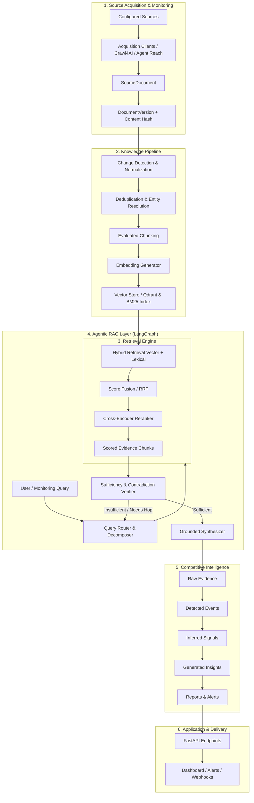

# Competitive Intelligence Monitoring Agent — Architectural Specification

## 1. System Overview

The **Competitive Intelligence Monitoring Agent** is a production-oriented intelligence engine designed to monitor public information across competitors (pricing pages, product docs, company blogs, job boards, GitHub, social platforms, news) and translate raw data changes into evidence-backed strategic insights.

Rather than acting as a simple Question-Answering RAG bot, the system implements an **Agentic RAG** architecture orchestrated via deterministic state graphs (**LangGraph**). The agent autonomously decides:
- Whether external retrieval is required.
- Which specific sources and strategies to query.
- How to rewrite or decompose multi-faceted queries.
- How to evaluate evidence credibility and detect cross-source contradictions.
- When to stop retrieval hops based on evidence sufficiency and cost/latency budgets.

> [!NOTE]
> **Subsystem Contracts Status**:
> All `models.py` and `interfaces.py` files in unbuilt subsystems currently serve as **provisional placeholders**, not finalized domain contracts. Each subsystem's contracts will be designed iteratively before implementation.

---

## 2. High-Level Architecture & Data Flow



---

## 3. Preferred External Tools & Tooling Policy

We strictly limit our external infrastructure to mature, preferred tooling:
- **Crawl4AI**: For web crawling and structured web extraction.
- **Agent Reach**: For supported platform/social sources (X, Reddit, GitHub, YouTube).
- **Qdrant**: For vector indexing, dense similarity search, and payload filtering.
- **LangGraph**: For deterministic, stateful agentic orchestration and multi-hop reasoning.

> [!IMPORTANT]
> **No Premature External Infrastructure**:
> Do NOT introduce or adopt additional external services (such as external message brokers, distributed task queues, or third-party monitoring platforms) simply because they appear in standard architecture diagrams. Additional tools must only be introduced when a concrete requirement justifies them.

---

## 4. Subsystems & Module Breakdown

### Subsystem 1: Source Acquisition & Monitoring (`src/competitive_intelligence/source_acquisition/`)
- **Purpose**: Manage configured data sources, schedule periodic checks, execute content retrieval via headless crawlers, APIs, or feeds, and capture content snapshots.
- **Key Concepts**:
  - `Source`: Represents *where* and *how* data is fetched (URL, credentials, monitoring schedule, priority, reliability score). Contains *no document text*.
  - `SourceDocument`: Unique identity of an entity within a source (e.g. `https://competitor.com/pricing`).
  - `DocumentVersion`: Immutable snapshot with timestamp, raw payload, and SHA-256 hash.
- **Tool Abstractions**:
  - `Crawl4AI`: General web scraping and structured DOM extraction.
  - `Agent Reach`: Social & platform sources (X/Twitter, Reddit, YouTube, GitHub).
  - `Feed / RSS / API`: Specialized fetchers for press releases and structured endpoints.

### Subsystem 2: Knowledge Pipeline (`src/competitive_intelligence/knowledge_pipeline/`)
- **Purpose**: Transform raw document versions into normalized, chunked, and searchable knowledge units.
- **Key Responsibilities**:
  - **Change Detection**: Deterministic hash and AST/DOM diffing before processing.
  - **Normalization**: Clean boilerplate, headers, navigation noise.
  - **Chunking Strategy**: Modular chunkers (Recursive Character, Semantic, Markdown/Document-aware) with evaluation.
  - **Vector Storage**: Qdrant client abstraction for dense vector indexing + hybrid lexical indexing.
  - **Provenance**: Every `DocumentChunk` contains `chunk_id`, `version_id`, `source_id`, `char_offsets`, and `collected_at`.

### Subsystem 3: Retrieval Engine (`src/competitive_intelligence/retrieval_engine/`)
- **Purpose**: Retrieve and rank candidate evidence snippets with high precision and recall.
- **Capabilities**:
  - **Dense Retrieval**: Qdrant cosine/dot-product similarity over dense embeddings.
  - **Sparse/Lexical Retrieval**: BM25 index for exact keywords, version numbers, and entity names.
  - **Hybrid Fusion**: Reciprocal Rank Fusion (RRF) combining dense and sparse ranks.
  - **Cross-Encoder Reranking**: Precision reranking for top-$K$ candidates before agent consumption.
  - **Retrieval Evaluation**: Benchmarking infrastructure for Recall@K, Precision@K, MRR, and NDCG.

### Subsystem 4: Agentic RAG (`src/competitive_intelligence/agentic_rag/`)
- **Purpose**: Stateful, budget-controlled decision-making for complex multi-source inquiries.
- **Orchestration**: Built with **LangGraph** using deterministic state machines.
- **Core Nodes**:
  1. `Query Understanding & Router`: Determines if retrieval is required, identifies target competitor/domain, selects retrieval strategies.
  2. `Query Decomposer & Rewriter`: Splits multi-part questions into sub-queries.
  3. `Retrieval Node`: Calls Subsystem 3 with bounded parameter ranges.
  4. `Verification & Sufficiency Evaluator` (CRAG/Self-RAG inspired): Checks if retrieved evidence answers the query and flags contradictions across sources.
  5. `Synthesis Node`: Generates responses where every factual assertion cites a `chunk_id` and `source_url`.
- **Safety & Budget Controls**: Hard ceilings on max LLM tokens, max retrieval hops, and total task latency.

### Subsystem 5: Competitive Intelligence (`src/competitive_intelligence/intelligence/`)
- **Purpose**: Higher-level reasoning to turn evidence changes into strategic business intelligence.
- **Entity Hierarchy**:
  1. `RawEvidence`: Grounded snippets from retrieved chunks.
  2. `DetectedEvent`: Discrete factual changes (e.g. "Competitor A discontinued Tier 1 plan").
  3. `InferredSignal`: Strategic implications (e.g. "Pivot towards enterprise-only customers").
  4. `GeneratedInsight`: Comprehensive analysis synthesizing multiple signals and historical data.
  5. `Alert` / `Report`: Structured outputs pushed to users based on severity and workspace preferences.

### Subsystem 6: Application Layer (`src/competitive_intelligence/application/`)
- **Purpose**: FastAPI backend exposing workspace management, competitor configuration, monitoring schedules, and intelligence reporting.
- **Data Model**:
  ```
  User ──▶ Workspace ──▶ TrackedCompetitors ──▶ Sources ──▶ Insights/Alerts
  ```

### Subsystem 7: Production, Operations & Budgets (`src/competitive_intelligence/core/`)
- **Purpose**: Production hardening, cost controls, observability, and resilience.
- **Capabilities**:
  - `LLMBudgetManager`: Enforces token and call count caps per task.
  - `StructuredLogger`: Structured JSON/console logging with correlation IDs.
  - `Resilience`: Exponential backoff and circuit-breaking via `tenacity`.
  - `Configuration`: Type-safe settings via `pydantic-settings`.

---

## 5. Key Design Principles & Invariants

1. **Replaceability**: External dependencies (Crawl4AI, Agent Reach, Qdrant, LLMs) are behind internal abstract interfaces.
2. **Provenance Integrity**: No insight may exist without traceable links down to `chunk_id` and `source_id`.
3. **Deterministic First**: Never use an LLM where deterministic hashing, diffing, or rules are adequate.
4. **Incremental Updates**: Monitoring checks process only modified content snapshots (`DocumentVersion`), avoiding full-corpus reindexing.
5. **Continuous Evaluation**: Retrieval and Agent decisions are tested against evaluation sets.

---

## 6. Open Architectural Decisions

The following decisions are deliberately deferred to the detailed design phase of the respective subsystems:

1. **Raw Content Storage Strategy**:
   - *Options*: Local file storage, database binary/text columns, or dedicated object storage.
   - *Decision point*: During Subsystem 1 / Subsystem 2 detailed design.
2. **Monitoring & Scheduling Mechanism**:
   - *Options*: Simple async in-process scheduler, event-driven triggers, or dedicated background queue.
   - *Decision point*: During Subsystem 1 detailed design.
3. **Crawl4AI Execution & Deployment Model**:
   - *Options*: In-process async Python library vs standalone containerized service.
   - *Decision point*: During Subsystem 1 detailed design.
