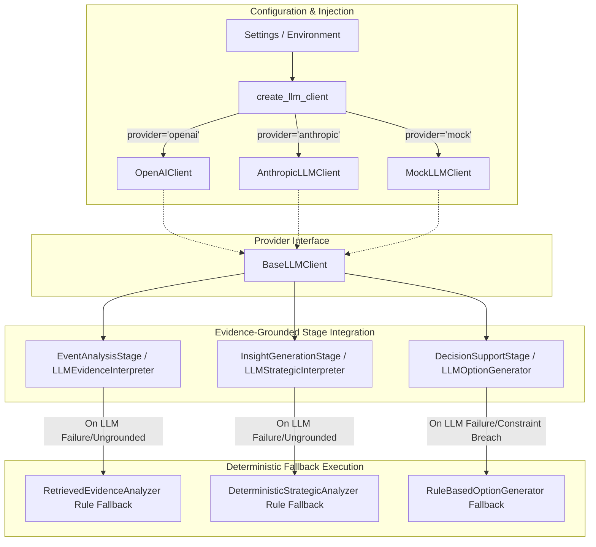

# LLM Integration Subsystem

## 1. Overview and Core Philosophy

The LLM Integration Subsystem bridges external Large Language Model capabilities into the Competitive Intelligence Monitoring Platform while adhering strictly to foundational architectural invariants:

1. **Deterministic-First Foundation**: Critical business rules (deduplication, normalization, vector projections, filtering, scoring, and status machines) remain 100% deterministic. LLMs are applied strictly where semantic extraction and strategic option formulation are beneficial.
2. **Provider Independence**: Analytical components program to `BaseLLMClient`, decoupling business workflows from provider-specific SDKs or wire formats.
3. **Evidence Grounding & Provenance**: Synthesized outputs must cite valid retrieved evidence chunk IDs, event IDs, or signal IDs. The system validates citations against the active context and discards ungrounded hallucinations.
4. **Resilience Without Domain Corruption**: In case of timeouts, provider outages, authentication failures, or malformed structured outputs, analytical stages execute deterministic rule-based fallbacks, setting `fallback_used: True` without corrupting persisted state.
5. **Human Decision Boundary**: Options generated or enriched by LLMs remain strictly `PROPOSED` recommendations. Autonomous execution of recommendations is explicitly prohibited.
6. **No Mock Substitution in Production**: In `environment="production"`, the client factory rejects `mock` provider configuration and fails fast.

---

## 2. Architecture & Components

### Component Breakdown

| Component | File Location | Responsibility |
| :--- | :--- | :--- |
| `BaseLLMClient` | `agentic_rag/llm/interfaces.py` | Provider-agnostic interface with `generate_structured()`, `generate_text()`, and provider metadata properties. |
| `LLMConfig` | `agentic_rag/llm/models.py` | Validated configuration model enforcing provider enums, timeouts, retries, and temperature bounds. |
| `OpenAIClient` | `agentic_rag/llm/openai_client.py` | Native async client using standard `httpx` and `response_format` JSON schema validation with exponential retry backoff. |
| `AnthropicLLMClient` | `agentic_rag/llm/anthropic_client.py` | Native async client using standard `httpx` with Anthropic tool-use schema enforcing structured returns and retries. |
| `MockLLMClient` | `agentic_rag/llm/mock_client.py` | Configurable testing mock parsing grounding context dynamically and adhering to schema constraints. |
| `create_llm_client` | `agentic_rag/llm/factory.py` | Central factory enforcing production validation (rejecting mock provider when `environment == "production"`). |
| `LLMEvidenceInterpreter` | `intelligence/events/evidence_analyzer.py` | Extracts factual intelligence events from retrieved chunk context; validates evidence citations. |
| `LLMStrategicInterpreter` | `intelligence/insights/llm_interpreter.py` | Formulates strategic insights from event and signal streams; verifies grounding against cited event/signal IDs. |
| `LLMOptionGenerator` | `decision_support/llm_generator.py` | Generates structured candidate options with predicted consequences and risks; subject to hard constraint validation. |

---

## 3. Configuration & Environment Variables

Provider configuration is managed in `Settings` (`core/config.py`):

| Variable | Type | Default | Description |
| :--- | :--- | :--- | :--- |
| `LLM_PROVIDER` | `str` | `"openai"` | Active provider: `"openai"`, `"anthropic"`, or `"mock"`. |
| `OPENAI_API_KEY` | `str` | `""` | API key for OpenAI endpoints. |
| `OPENAI_MODEL` | `str` | `"gpt-4o"` | Model identifier for OpenAI requests. |
| `OPENAI_BASE_URL` | `str` | `"https://api.openai.com/v1"` | Base URL for OpenAI API or compatible gateway. |
| `ANTHROPIC_API_KEY` | `str` | `""` | API key for Anthropic endpoints. |
| `ANTHROPIC_MODEL` | `str` | `"claude-3-5-sonnet-20241022"`| Model identifier for Anthropic requests. |
| `LLM_TIMEOUT_SECONDS` | `float`| `30.0` | Timeout per HTTP request in seconds. |
| `LLM_MAX_RETRIES` | `int` | `2` | Maximum retry attempts for transient 429/5xx errors. |
| `LLM_TEMPERATURE` | `float`| `0.0` | Temperature setting (0.0 enforces deterministic sampling). |
| `TASK_TOKEN_BUDGET` | `int` | `5000` | Max total tokens allowed across hops before early termination. |
| `MAX_LLM_CALLS_PER_TASK` | `int` | `5` | Maximum number of LLM invocations allowed per workflow run. |

---

## 4. Evidence Grounding & Verification Invariants

1. **Observation vs. Interpretation Separation**:
   - `IntelligenceEvent` represents verified factual occurrences extracted directly from acquired text.
   - `Insight` represents analytical interpretations, explicitly categorizing confidence into `factual_confidence` (grounded in events) and `interpretive_confidence` (analytical assessment).
2. **Citation Validation**:
   - Any LLM-proposed event must cite existing `chunk_id` values present in the input prompt.
   - Any LLM-proposed insight must cite existing `event_id` or `signal_id` values present in the input prompt.
   - Any LLM candidate citing nonexistent or hallucinated IDs is discarded.
3. **Uncertainty Representation**:
   - When evidence is contradictory or incomplete, candidate insights are tagged with `is_uncertain: True`, capped at a confidence score `<= 0.5`, and routed into unresolved uncertainty tracking.

---

## 5. Decision Support & Human Approval Boundary

1. **Authoritative Objectives and Constraints**:
   - User-defined `business_objectives` and `constraints` remain strictly authoritative.
   - Candidate options generated by `LLMOptionGenerator` are passed into `DeterministicDecisionAnalyzer` to apply hard constraint gates (budget ceilings, risk tolerances). Options violating hard constraints are eliminated regardless of LLM rationale.
2. **Recommendation Lifecycle**:
   - All newly generated recommendations are assigned status `RecommendationStatus.PROPOSED`.
   - The platform strictly enforces that recommendations cannot be transitioned to `ACCEPTED` or executed without authenticated human review.
